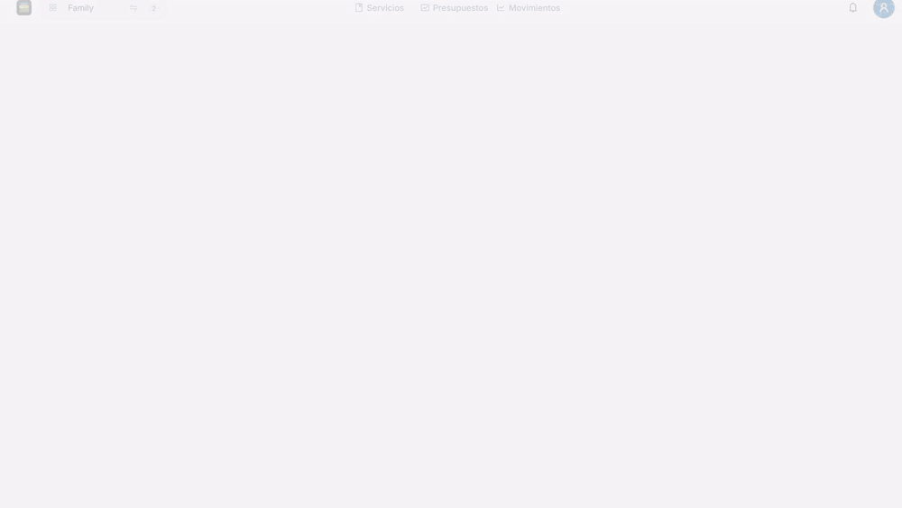

<div align="center">

# Movements

**Gestión financiera personal, simple y en tiempo real.**
Cargá tus gastos, controlá tus servicios, armá presupuestos y mirá todo en un solo dashboard.


<a href="docs/template.mp4">
  
</a>

▶ [Ver el video completo (con música, 40 s)](docs/template.mp4)

</div>

---

## Qué podés hacer

| Sección | Para qué sirve |
| --- | --- |
| **Dashboard** | Resumen del mes (ingresado, gastado, diferencia), presupuestos en alerta, insights de gasto y metas de ahorro. |
| **Servicios** | Lista de pagos recurrentes del mes. Marcá cada uno como pagado y mirá cuánto te queda pendiente. |
| **Presupuestos** | Definí un monto por categoría (recurrente, único o anual) y seguí el porcentaje utilizado. |
| **Movimientos** | Registrá débitos, créditos, ingresos y reintegros. Filtrá, exportá a CSV/PDF y categorizá varios de una. |
| **Más** | Metas de ahorro, utilidades (calculadora de tiempo de recuperación), ajustes y centro de ayuda. |

Además: grupos de usuarios (workspaces) con roles `ADMIN`, `FAMILY` y `GUEST`, actualización en tiempo real por WebSocket, interfaz en español/inglés y modo claro/oscuro.

---

## Tutorial: usar la app en 4 pasos

### 1. Cargá tu primer movimiento

1. Entrá a **Movimientos** y tocá **Movimiento**.
2. Completá **Pago** (monto, moneda, banco, tipo y fecha) y **Clasificación** (descripción y categoría).
3. Tocá **Agregar**. El movimiento aparece arriba de la tabla.

> 💡 ¿Tenés el resumen del banco? En la misma ventana está la pestaña **Importar PDF**: por ahora funciona con Santander (PDF de movimientos de cuenta o extracto de tarjeta de crédito) y avisa cuáles ya estaban cargados.

### 2. Pagá tus servicios

1. Entrá a **Servicios** y completá **Nuevo Servicio** (descripción, monto y moneda).
2. Cuando pagues uno, tocá **Marcar como pagado**.
3. El resumen de arriba se actualiza solo: monto pendiente y cantidad de servicios al día.

### 3. Creá un presupuesto

1. Entrá a **Presupuestos** y tocá **+ Agregar presupuesto**.
2. Elegí moneda, categoría, monto y tipo (**Recurrente**, **Único** o **Anual**).
3. Mirá la barra de progreso: verde mientras estás dentro del límite, roja cuando te excedés.

### 4. Categorizá varios movimientos de una

1. En **Movimientos**, tildá las filas que quieras.
2. Aparece la barra con **N seleccionados**: tocá **Categorizar**.
3. Elegí hasta 2 categorías y **Aplicar**. También podés **Eliminar** en lote (con tiempo para deshacer).

---

## Tutorial: correr el proyecto en tu máquina

### Requisitos

- **Node.js 24** y **pnpm 10** (son las versiones que usa la CI).
- Un backend de Movements (Spring Boot) corriendo en `http://localhost:8081`.
- Acceso al Keycloak configurado en `config/` (el login es obligatorio al cargar la app).

### Pasos

```bash
# 1. Clonar
git clone https://github.com/matiasferrerovilas/fe-movements.git
cd fe-movements

# 2. Instalar dependencias
pnpm install

# 3. Levantar en modo desarrollo (usa config/config.local.js)
pnpm dev
```

Abrí la URL que muestra Vite (normalmente <http://localhost:5173>) e iniciá sesión.

¿Querés apuntar al backend de producción? Usá `pnpm dev:prod` (toma `config/config.prod.js`).

### Configuración

No hay archivos `.env`. La app lee su configuración de `window.env`, que Vite sirve como `/config.js` a partir de los archivos de `config/`:

```js
window.env = {
  environment: "local",
  keycloak: { clientId: "...", realm: "...", url: "https://tu-keycloak" },
  backend: {
    api: "http://localhost:8081/v1",      // ya incluye /v1
    websocketUrl: "http://localhost:8081",
  },
};
```

En producción, `vite build` incluye `config/config.prod.js` como `config.js`.

### Scripts

| Comando | Qué hace |
| --- | --- |
| `pnpm dev` | Servidor de desarrollo con recarga en caliente. |
| `pnpm dev:prod` | Igual, pero con la configuración de producción. |
| `pnpm build` | Chequea tipos y genera `dist/`. |
| `pnpm preview` | Sirve el build localmente. |
| `pnpm lint` | Corre ESLint. |
| `pnpm test` | Corre los tests con Vitest (`--watch` para modo watch). |
| `pnpm test:coverage` | Tests con reporte de cobertura. |

---

## Stack

React 19 · TypeScript (strict) · Vite 7 · TanStack Router y Query · Ant Design 6 · Keycloak · STOMP/SockJS · Axios · DayJS · Recharts · Vitest + Testing Library + MSW.

## Estructura

```
src/
├── apis/          # Axios, hooks de React Query, auth, WebSocket, workspaces
├── components/    # UI por funcionalidad (home, movements, services, budgets...)
├── routes/        # Rutas file-based de TanStack Router
├── models/        # Interfaces de dominio
├── enums/         # Enums con patrón `as const`
├── i18n/          # Traducciones es / en
└── utils/         # Utilidades puras
tests/             # Espeja la estructura de src/
config/            # window.env para local y producción
docs/              # Video y capturas del README
```

## Despliegue

La CI (`.github/workflows/frontend-ci.yml`) instala dependencias, corre lint, tests y build, y empaqueta `dist/` en una imagen **nginx** (ver `Dockerfile` y `nginx.conf`). Cada cambio en `main` se taggea con la versión de `package.json`.

## Contribuir

- Todo código nuevo lleva su test en `tests/` (misma ruta que en `src/`).
- Los imports internos usan el alias `@/`.
- Cada cambio sube la versión de `package.json` siguiendo [semver](https://semver.org/lang/es/) y se anota en el [CHANGELOG](CHANGELOG.md).
- Commits con [Conventional Commits](https://www.conventionalcommits.org/es/v1.0.0/) (`feat:`, `fix:`, `docs:`...).
- Más detalle de convenciones en [CLAUDE.md](CLAUDE.md).
